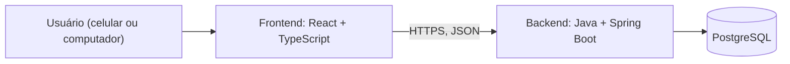
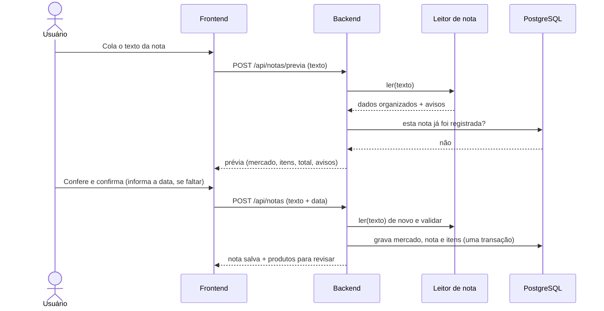

# Arquitetura: Controle de Compras de Mercado

| | |
|---|---|
| **Versão** | 0.1 (rascunho) |
| **Data** | 27/10/2026 |
| **Autor** | Gustavo |
| **Baseado em** | [Requisitos v0.3](01-requisitos.md) |

---

## 1. Visão geral

O sistema é um **monólito**: um único backend que concentra toda a lógica, um frontend e um banco de dados. Para um projeto desenvolvido por uma pessoa e usado por poucos usuários, isso é o mais simples de construir, testar e colocar no ar. Dividir em microsserviços só traria complexidade sem benefício.



## 2. Peças e responsabilidades

| Peça | Tecnologia | Responsabilidade |
|---|---|---|
| Frontend | React + TypeScript (Vite) | Telas, formulários, gráficos. Não contém regra de negócio |
| Backend | Java + Spring Boot | Autenticação, leitura e validação da nota, regras de negócio, consultas de gasto e preço |
| Banco de dados | PostgreSQL | Guardar usuários, notas, itens, produtos e mercados |

Regra de ouro: **o frontend só mostra e coleta; quem decide e valida é o backend.** Tudo o que importa (soma da nota, nota duplicada, dados de cada usuário) é verificado no servidor, porque o navegador pode ser manipulado.

## 3. Organização do backend

O código é organizado **por funcionalidade**, e não por tipo de arquivo. Cada pasta cuida de um assunto:

```
backend/src/main/java/.../
├── usuario/     cadastro, login, segurança
├── nota/        receber o texto, prévia, salvar, listar, excluir
├── leitor/      leitor do texto da NFC-e (Java puro, sem Spring)
├── mercado/     lojas, identificadas pelo CNPJ
├── produto/     produtos, categorias, associação entre nomes
└── relatorio/   gasto do mês, por categoria, evolução de preço
```

Dentro de cada pasta, o padrão é `controller` (recebe a requisição) → `service` (regra de negócio) → `repository` (acesso ao banco).

O módulo **`leitor/` é Java puro, sem dependência do Spring**. Isso é proposital (RNF08): é a parte mais frágil do sistema, porque depende do formato do texto da SEFAZ. Isolado, ele é fácil de testar com notas reais e fácil de trocar se o formato mudar.

## 4. Fluxo principal: registrar uma nota



Decisões de projeto desse fluxo:

1. **A prévia não grava nada.** Só lê, valida e mostra ao usuário. Se ele desistir, nada fica no banco.
2. **Ao confirmar, o frontend reenvia o texto e o backend lê de novo.** O backend não confia nos dados que voltam do navegador, e assim não precisa guardar estado entre a prévia e a confirmação.
3. **O texto bruto nunca é gravado**, nem em banco nem em log (ele pode conter CPF). O backend não deve registrar o corpo dessas requisições.
4. **A gravação é uma transação única:** ou grava mercado, nota e todos os itens, ou não grava nada.
5. **Categoria e associação de produtos vêm depois de salvar.** A nota é registrada na hora, e os itens novos entram numa lista "para revisar". Isso evita travar o usuário num formulário (RNF01). Enquanto não revisados, os itens aparecem como "Sem categoria".

## 5. Como o sistema reconhece o mesmo produto (RF12)

O nome do produto muda de mercado para mercado ("ARROZ TIO JOAO T1 5KG" e "ARROZ TIO JOAO TIPO 1 5 KG"), e o código do item é interno de cada loja (RN05). Sem usar IA, o reconhecimento funciona em camadas:

1. **Nome normalizado** (maiúsculas, sem acento nem pontuação).
2. **Apelido já conhecido:** se aquele nome já foi associado a um produto naquela loja, o item é ligado automaticamente.
3. **Sugestões:** se não for conhecido, o sistema procura produtos parecidos (similaridade de texto no PostgreSQL) e sugere. O mesmo nome exato em outra loja aparece como sugestão de alta confiança.
4. **Confirmação do usuário:** com um toque ele aceita a sugestão ou cria um produto novo. O sistema **lembra** (RN08), e com o tempo quase não pergunta mais.

O peso ou volume que aparece no nome (1kg, 200ML, 395G) é extraído ao confirmar o produto, para permitir comparar o preço por kg ou por litro (RN03).

No v1, produtos e apelidos pertencem a **cada usuário**. É mais simples e protege a privacidade. Um catálogo compartilhado entre usuários fica para uma versão futura.

## 6. API (rascunho do contrato)

| Método e rota | O que faz |
|---|---|
| `POST /api/auth/cadastro` e `POST /api/auth/login` | Criar conta e entrar |
| `POST /api/notas/previa` | Ler o texto e devolver a prévia, sem gravar |
| `POST /api/notas` | Confirmar e gravar a nota |
| `GET /api/notas` e `GET /api/notas/{id}` | Histórico e detalhe de uma nota |
| `DELETE /api/notas/{id}` | Excluir uma nota |
| `GET /api/produtos/pendentes` | Itens sem categoria ou sem associação |
| `PUT /api/produtos/{id}` e `POST /api/produtos/associar` | Definir categoria; associar nomes ao mesmo produto |
| `GET /api/produtos/{id}/precos` | Evolução do preço e comparação entre mercados |
| `GET /api/relatorios/mes?ano=&mes=` | Total do mês, por categoria, comparação com o mês anterior, progresso da meta |
| `PUT /api/usuario/meta` | Definir a meta mensal |
| `DELETE /api/usuario` | Excluir a conta e todos os dados (LGPD) |

## 7. Segurança e privacidade

- Senha guardada com hash (BCrypt), nunca em texto puro.
- **Toda consulta ao banco filtra pelo usuário logado.** Não existe regra automática no banco para isso, então ela é responsabilidade do código, e cada endpoint tem teste automatizado que garante que um usuário não vê dados de outro.
- O CPF que vem no texto é ignorado pelo leitor e não aparece em nenhum resultado.
- Corpo das requisições de nota não vai para logs.
- HTTPS em produção; segredos (senha do banco, chave do token) em variáveis de ambiente, fora do repositório.
- Exclusão de conta apaga todos os dados do usuário (RF18).

## 8. Como a arquitetura atende os requisitos principais

| Requisito | Como é atendido |
|---|---|
| RNF01 (rápido, sem digitação) | Prévia imediata; categoria e associação são revisadas depois de salvar |
| RNF03 (precisão em dinheiro) | `BigDecimal` no Java, `NUMERIC` no banco, nunca `double` |
| RNF04 (privacidade) | Texto bruto e CPF não são gravados; dados isolados por usuário |
| RNF08 (manutenção) | Leitor isolado em módulo próprio, testado com notas reais anonimizadas |
| RNF09 (confiabilidade) | Validações da nota (RN02) antes de gravar; erro claro se não conferir |
| RNF07 (custo) | Monólito simples, uma única aplicação para hospedar |

## 9. Ambientes

- **Desenvolvimento:** PostgreSQL em Docker (Docker Compose), backend e frontend rodando na máquina.
- **Integração contínua:** GitHub Actions rodando os testes a cada Pull Request (a partir do primeiro teste).
- **Produção:** a definir (ver decisões abertas).

## 10. Decisões ainda abertas

1. Como o frontend guarda o token de login (cookie protegido ou outra forma). Será registrada em uma decisão própria antes de implementar o login.
2. Onde hospedar backend e banco. Hospedagem gratuita para Java é mais limitada, e os planos atuais precisam ser conferidos antes de decidir (risco R6).
3. Biblioteca de componentes visuais do frontend.
4. Estratégia de migração do banco (proposta: Flyway, com scripts versionados no repositório).

## 11. Decisões já registradas

- [0001: Não ler automaticamente o site da Fazenda](decisoes/0001-nao-ler-site-da-fazenda.md)
- [0002: Entrada de notas por texto copiado](decisoes/0002-entrada-por-copiar-e-colar.md)
- [0003: Java, Spring Boot, PostgreSQL e React](decisoes/0003-stack-java-spring-boot.md)

Modelo de dados: [03-modelo-de-dados.md](03-modelo-de-dados.md)
