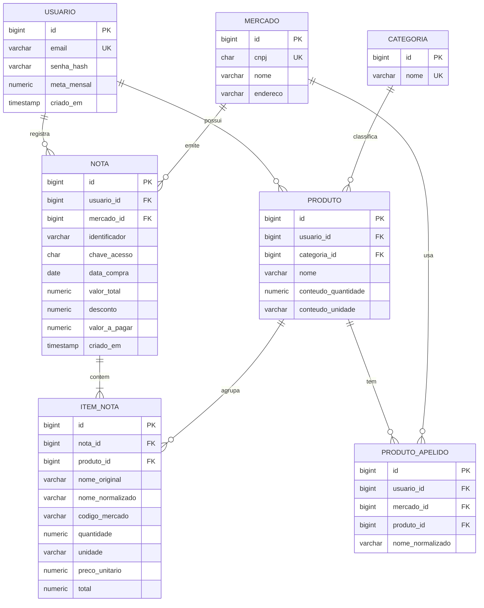

# Modelo de Dados: Controle de Compras de Mercado

| | |
|---|---|
| **Versão** | 0.1 (rascunho) |
| **Data** | 27/10/2026 |
| **Banco** | PostgreSQL |
| **Baseado em** | [Requisitos v0.3](01-requisitos.md) e [Arquitetura](02-arquitetura.md) |

---

## 1. Diagrama



## 2. Tabelas

| Tabela | Para que serve |
|---|---|
| `usuario` | Quem tem conta. Guarda também a meta mensal (opcional, um único valor) |
| `mercado` | Uma loja, identificada pelo CNPJ completo (RN07). Dado público, compartilhado entre usuários |
| `nota` | Uma compra. Pertence a um usuário e a um mercado |
| `item_nota` | Cada linha da nota, com o nome exatamente como veio e o nome normalizado |
| `produto` | Produto "de verdade" do usuário, que agrupa itens de nomes diferentes (RF12) |
| `produto_apelido` | Memória do sistema: "nesta loja, este nome normalizado é este produto" (RN08) |
| `categoria` | Lista fixa de categorias, criada por script de migração (Hortifruti, Carnes, Laticínios, Bebidas, Padaria, Mercearia, Congelados, Limpeza, Higiene, Outros) |

## 3. Regras e restrições

**Dinheiro e quantidades**
- Valores monetários em `NUMERIC` (nunca `FLOAT` ou `DOUBLE`); no Java, `BigDecimal` (RNF03).
- Quantidade com 3 casas decimais, porque a nota traz pesos como 0,245 kg.
- `item_nota.total` guarda o valor impresso na nota, sem recalcular (RN01).

**Identidade da nota (RN06)**
- A coluna `identificador` é obrigatória e única **por usuário** (`UNIQUE (usuario_id, identificador)`).
- Valor dela: a chave de 44 dígitos, se existir; senão `cnpj|serie|numero`; senão uma impressão digital (hash de CNPJ, data, total e itens).
- A chave de 44 dígitos fica também em `chave_acesso` (pode ser nula).
- A unicidade é por usuário para que duas pessoas da mesma casa possam registrar a mesma compra, cada uma na sua conta. Evitar a contagem dupla dentro de uma família não é objetivo da v1.

**Privacidade (RNF04)**
- Não existe coluna para o texto bruto da nota nem para o CPF do consumidor.
- `produto` e `produto_apelido` têm `usuario_id`: cada usuário só enxerga os seus.
- Nenhuma consulta pode ser feita sem filtrar por `usuario_id` (nas tabelas que têm essa coluna, ou pela ligação com `nota`).

**Ligações**
- `item_nota.produto_id` é **opcional**: o item é salvo antes de ser associado a um produto (arquitetura, seção 4).
- `produto.categoria_id` também é opcional; sem ela, o item aparece como "Sem categoria".
- `produto_apelido` tem `UNIQUE (usuario_id, mercado_id, nome_normalizado)`.
- Excluir um usuário apaga em cascata suas notas, itens, produtos e apelidos (RF18). Excluir uma nota apaga seus itens.

**Índices (o que as telas vão consultar)**
- `nota (usuario_id, data_compra)`: gasto do mês e histórico.
- `item_nota (nota_id)` e `item_nota (produto_id)`: itens de uma nota e histórico de preço de um produto.
- `item_nota (nome_normalizado)` com índice de similaridade (`pg_trgm`): sugestões de produtos parecidos.

## 4. Como os números das telas saem do banco

**Gasto do mês** é a soma de `nota.valor_a_pagar` no período (RN11).

**Gasto por categoria do mês** soma os itens pelo valor bruto:

```sql
SELECT COALESCE(c.nome, 'Sem categoria') AS categoria,
       SUM(i.total)                      AS gasto
FROM item_nota i
JOIN nota n            ON n.id = i.nota_id
LEFT JOIN produto p    ON p.id = i.produto_id
LEFT JOIN categoria c  ON c.id = p.categoria_id
WHERE n.usuario_id = :usuarioId
  AND n.data_compra >= :inicioDoMes
  AND n.data_compra <  :inicioDoProximoMes
GROUP BY c.nome
ORDER BY gasto DESC;
```

Como a nota não diz a qual item o desconto se aplica, a soma das categorias pode ser maior que o gasto do mês. A diferença é mostrada na tela como "Descontos" (RN11). Na nota do atacadista usada nos testes: itens somam R$ 589,91, desconto de R$ 16,51, valor pago R$ 573,40.

**Preço por kg ou litro:** se a unidade do item é `KG`, o `preco_unitario` já é por kg. Se for `UN` ou `PC`, divide-se o preço pelo `conteudo_quantidade` do produto (por exemplo, 1 kg ou 0,395 kg), quando esse conteúdo foi identificado (RN03).

## 5. Pontos de atenção

- **Preço mais caro/mais barato só faz sentido com produtos associados.** Itens sem produto não entram nas comparações até serem revisados.
- **Sacolas e itens parecidos** entram no gasto, mas podem ser excluídos das comparações (RN10, ainda a definir como marcar).
- **Notas de outros mercados** podem trazer campos que o modelo ainda não prevê (acréscimos, mais de uma forma de pagamento). Por isso as notas dos 6 mercados dos entrevistados vão ser testadas antes de fixar o modelo (risco R5).
- O modelo muda com o tempo: cada alteração vira um script de migração versionado no repositório.
